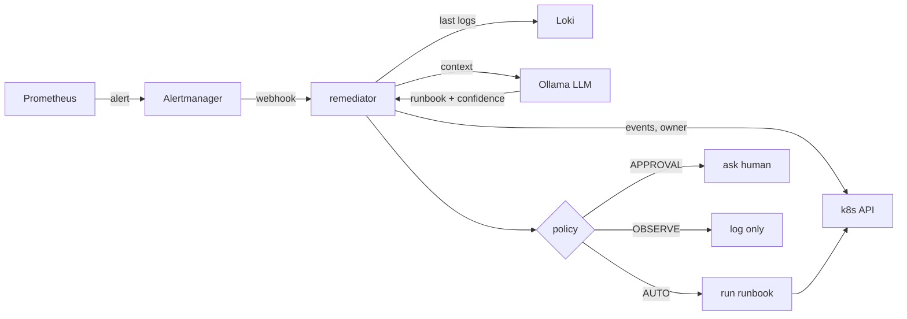

# k3s-ai-remediation


When an alert fires on my k3s cluster, this service collects the context an engineer would look at (events, owner, last log lines), asks a local LLM which fix to apply, and applies it only if the fix is on an allowlist and the safety policy allows it. Then it logs everything.

It grew out of [k8s-platform-intelligence](https://github.com/sunkaradp/k8s-platform-intelligence), where I predicted memory pressure but stopped at "observe". This project is the next step: actually fixing things, safely.

## How it works



**The LLM never runs commands.** It can only pick one of these runbooks:

| Runbook | Risk | What it does |
|---|---|---|
| `restart_pod` | low | deletes the pod so the Deployment recreates it |
| `scale_up` | low | +1 replica, capped at `MAX_REPLICAS` |
| `increase_memory` | medium | raises the memory limit x1.5, capped at `MEMORY_MAX_MI` |
| `rollback_deployment` | medium | same as `kubectl rollout undo` |
| `none` | - | do nothing |

If the LLM is down, slow, returns broken JSON or picks something outside the list, a rule-based fallback decides instead.

**Safety policy**

- `REMEDIATION_MODE` is the ceiling for the whole cluster: `OBSERVE` (default), `APPROVAL` or `AUTO`
- Only **low-risk** runbooks with confidence ≥ 0.8 run automatically
- Medium-risk runbooks always need a human
- Confidence < 0.5 → observe only
- `DRY_RUN=true` by default, so a fresh install never changes anything
- RBAC gives the service only the verbs the runbooks need (no secrets, no namespaces, no exec)

## Repo layout

```
remediator/        FastAPI service: webhook, context, diagnosis, policy, runbooks + tests
deploy/remediator/ Kustomize manifests (least-privilege RBAC, non-root, read-only FS)
monitoring/        kube-prometheus-stack values (Alertmanager -> webhook) + extra alert rules
gitops/argocd/     App-of-apps: monitoring, Loki, alert rules, remediator
terraform/         Hetzner server + firewall, k3s via cloud-init
chaos/             Scenarios that break the cluster on purpose
.github/workflows/ ruff, pytest, kubeconform, terraform validate, Docker build, Trivy, push to GHCR
```

## Run it

```bash
# 1. Infra
cd terraform
cp terraform.tfvars.example terraform.tfvars   # fill in token + your IP
terraform init && terraform apply
# run the get_kubeconfig command from the output, then:
export KUBECONFIG=$PWD/kubeconfig

# 2. Argo CD + everything else
kubectl create namespace argocd
kubectl apply -n argocd -f https://raw.githubusercontent.com/argoproj/argo-cd/stable/manifests/install.yaml
kubectl apply -f ../gitops/argocd/root-app.yaml

# 3. Break something
../chaos/run.sh oomkill
kubectl -n remediation logs deploy/remediator -f | grep audit
```

Local tests:

```bash
cd remediator
pip install -e ".[dev]"
pytest -q
```

## Results

Filled in from chaos runs (milestone 4).

| Scenario | Correct diagnosis | Fixed | Time to recover |
|---|---|---|---|
| OOMKilled | - | - | - |
| CrashLoopBackOff | - | - | - |
| Bad image tag | - | - | - |

## Roadmap

- [x] **1. Base:** webhook, context collection, rule + LLM diagnosis, policy, 4 runbooks, tests, CI
- [ ] **2. Cluster:** Terraform apply on Hetzner, Argo CD syncing all apps, alerts reaching the webhook
- [ ] **3. LLM + approval:** Ollama in-cluster, Slack approve/reject buttons for the APPROVAL tier
- [ ] **4. Verify + results:** check the alert resolves after a fix (roll back if not), run chaos suite, fill the table, demo GIF
