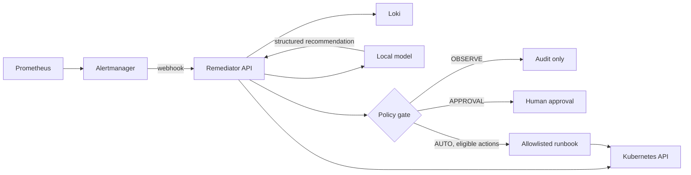

# Kubernetes Incident Remediation for k3s

A Kubernetes remediation service that connects alert context, local LLM-assisted diagnosis, policy evaluation and a small set of predefined runbooks.

The design goal is controlled automation: the model can recommend an action, but it cannot execute arbitrary commands. A policy layer decides whether a runbook is observed, sent for approval or eligible to run.

## Architecture



## Design and safety controls

- **Constrained actions:** the model selects from named runbooks; it does not receive shell or Kubernetes command execution.
- **Policy ceiling:** `REMEDIATION_MODE` supports `OBSERVE`, `APPROVAL` and `AUTO`.
- **Risk separation:** medium-risk actions require human approval; automatic execution is restricted to eligible low-risk actions above the configured confidence threshold.
- **Safe defaults:** `DRY_RUN=true` by default.
- **Fallback behavior:** invalid model output or an unavailable model falls back to rule-based diagnosis.
- **Least privilege:** the service RBAC is scoped to the resources and verbs required by the runbooks.

## Available runbooks

| Runbook | Risk | Intended operation |
|---|---|---|
| `restart_pod` | Low | Delete a pod managed by a controller so it can be recreated |
| `scale_up` | Low | Increase replicas within the configured cap |
| `increase_memory` | Medium | Increase a workload memory limit within the configured cap |
| `rollback_deployment` | Medium | Request a Deployment rollout rollback |
| `none` | — | Take no action |

## Repository structure

```text
remediator/         FastAPI webhook, context collection, diagnosis, policy, runbooks and tests
deploy/remediator/  Kustomize manifests and RBAC
monitoring/         Prometheus stack values and alert rules
gitops/argocd/      Argo CD application definitions
terraform/          Example Hetzner infrastructure provisioning
chaos/              Fault-injection scenarios
.github/workflows/  Lint, tests, manifest validation, Terraform validation and image checks
```

## Local development

```bash
cd remediator
python -m venv .venv
source .venv/bin/activate
pip install -e ".[dev]"
pytest -q
```

The repository also contains deployment examples for a k3s cluster. Review `terraform/terraform.tfvars.example` and the deployment manifests before applying anything to a real environment. Supply provider tokens and cluster-specific values through local, untracked configuration or your CI secret store.

## Current implementation status

The initial service milestone includes the webhook, context collection, rule-based and LLM-assisted diagnosis, policy evaluation, runbooks, tests and CI configuration.

The end-to-end cluster deployment, approval integration and chaos-test verification are tracked separately in the roadmap. The results table is intentionally not populated until repeatable test evidence is available.

| Scenario | Diagnosis | Remediation | Recovery time |
|---|---|---|---|
| OOMKilled | Not yet reported | Not yet reported | Not yet measured |
| CrashLoopBackOff | Not yet reported | Not yet reported | Not yet measured |
| Bad image tag | Not yet reported | Not yet reported | Not yet measured |

## Roadmap

- [x] Initial service, policy layer, runbooks, tests and CI
- [ ] Provision and validate the target k3s cluster
- [ ] Verify alert delivery and GitOps synchronization
- [ ] Complete local-model and human-approval integration
- [ ] Run the chaos suite and publish measured outcomes

## Related work

This project builds on [k8s-platform-intelligence](https://github.com/sunkaradp/k8s-platform-intelligence), which explores early warning signals for node memory pressure and intentionally stops at observe-only recommendations.
